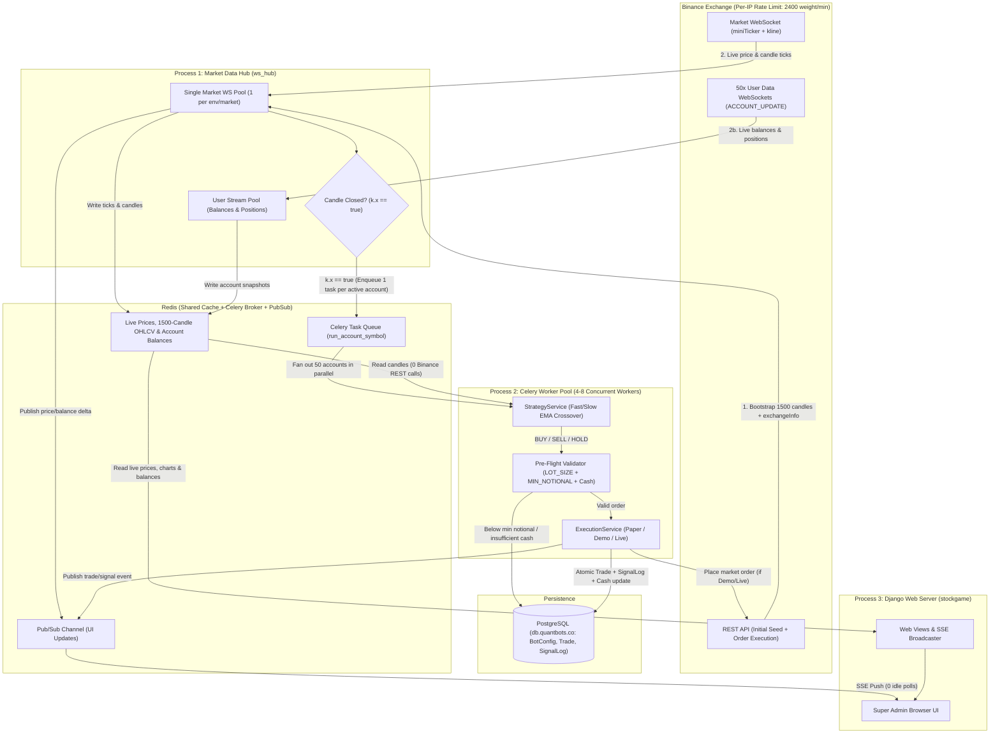
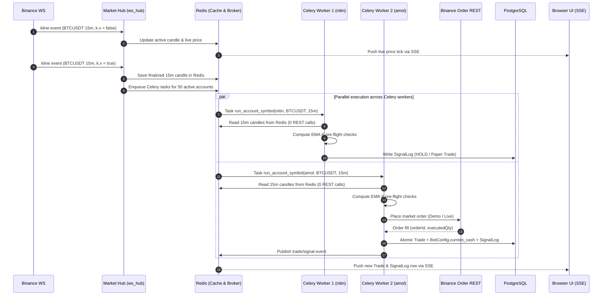

# StockGame — 50-Account Optimized Architecture & Flow Guide

This document defines the **target production architecture** for scaling StockGame to **50+ accounts (~300+ bots)** with sub-second reaction time, parallel per-account execution, and zero Binance IP rate-limit bans (`-1003`).

---

## 1. Current vs. Target 50-Account Architecture

### Current Architecture (2 Processes, In-Memory WS)
- `stockgame` (web) and `stockgame-bot` (60s polling loop) run as separate PM2 processes, each holding its own in-memory WebSocket cache.
- `run_all_active_bots()` iterates sequentially over bots, which becomes a bottleneck at 50 accounts (300+ bots).

### Target Architecture (`Market Data Hub + Redis + Celery Workers`)

---

## 2. Event-Driven Execution Flow (50 Accounts in Parallel)

When Binance emits a closed candle (`k.x == true`), the Market Hub writes the finalized candle to Redis **once** and dispatches Celery tasks for all active accounts on that `(symbol, interval)` to execute concurrently:

---

## 3. Why This Scales to 50+ Accounts (300+ Bots)

### 1. Zero Duplicate Market REST or WebSocket Connections
- Binance rate limits (`2,400 weight/min` on Futures) are enforced **per server IP**, not per account.
- **Process 1 (`ws_hub`)** maintains **one** market WebSocket per `(environment, market)` regardless of whether you have 2 accounts or 50 accounts, and stores candles/prices in **Redis**.
- Neither Celery workers nor the Django web server ever need to hit Binance REST for market data.

### 2. True Parallel Execution via Celery Workers
- Instead of `run_all_active_bots()` in [tasks.py](file:///Users/amolc/2026/stockgame/trading/tasks.py) looping sequentially through 300 bots, `ws_hub` enqueues one Celery task per active `(account_id, symbol)` on candle close.
- **4–8 concurrent Celery workers** process all 50 accounts in parallel in `< 1s`, with automatic retries and fault isolation (one account's API error never delays the other 49).
- PostgreSQL (`db.quantbots.co` in [settings.py](file:///Users/amolc/2026/stockgame/stockgame/settings.py)) handles concurrent Celery writes cleanly.

### 3. Pre-Flight Exchange Filter Validation (`MIN_NOTIONAL` & `LOT_SIZE`)
- `BinanceService.round_quantity()` ([binance_service.py](file:///Users/amolc/2026/stockgame/trading/services/binance_service.py)) and `ExecutionService` ([execution_service.py](file:///Users/amolc/2026/stockgame/trading/services/execution_service.py)) should validate both `LOT_SIZE` and `MIN_NOTIONAL` (from cached `exchangeInfo`) *before* calling `place_market_order()`.
- Prevents wasted REST weight and `-4164` rejected-order errors across 300 bots.

### 4. Thin Django Web Server + SSE Push
- The web server (`stockgame`) reads live prices, candles, and balances directly from **Redis** and pushes deltas to the browser via Server-Sent Events (SSE), eliminating redundant WebSockets and 1s browser polling.

### 5. Safety-Net Reconciliation Sweep
- Keep a lightweight `5m` Celery Beat periodic task that checks if any active bot missed a candle close during a WebSocket reconnect, using `SignalLog` deduplication so already-evaluated candles are skipped.
