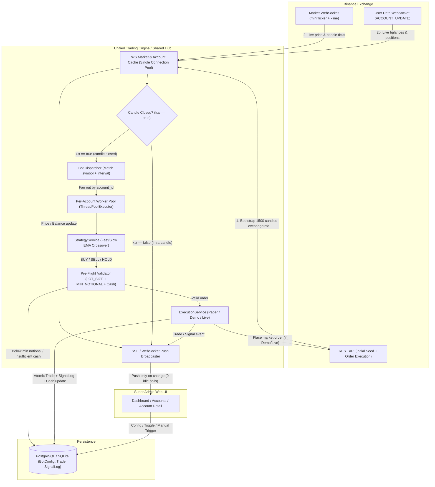
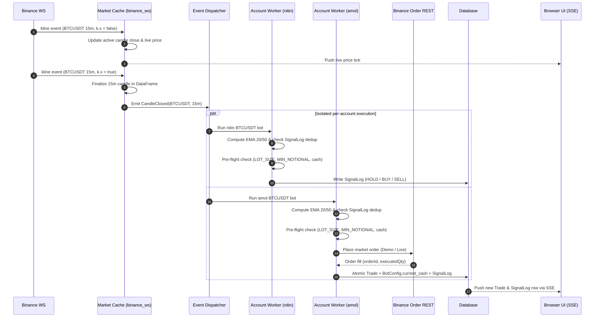

# StockGame — Optimized Architecture & Flow Guide

This document compares the **current** 2-process polling architecture with a **target optimized, event-driven architecture** designed for low latency, zero wasted Binance REST weight, and fault isolation across multiple trading accounts.

---

## 1. Current vs. Optimized Architecture

### Current Architecture (Dual-Process + Interval Polling)
- PM2 runs two independent Python processes (`stockgame` web server and `stockgame-bot` daemon), each maintaining its own `ws_manager` WebSocket connections.
- `run_bot` wakes up every `60s` and iterates sequentially over all active bots across all accounts.
- The browser polls `/api/status/` every `1–2s`.

### Target Optimized Architecture (Single Market Hub + Event-Driven Workers)

---

## 2. Event-Driven Execution Flow (Candle Close to Order)

Instead of waiting up to `60s` on a timer (`time.sleep(interval_sec)`), execution is triggered **the instant Binance emits a closed candle (`k.x == true`)**:

---

## 3. Key Optimizations Explained

### 1. Event-Driven Candle Close Trigger (vs. 60s Polling)
- **Current**: `manage.py run_bot` ([run_bot.py](file:///Users/amolc/2026/stockgame/trading/management/commands/run_bot.py)) sleeps `60s` between cycles and evaluates every active bot regardless of whether its timeframe (`15m`, `1h`, `4h`) has a new closed candle.
- **Optimized**: Hook into `_handle_market_message()` in [binance_ws.py](file:///Users/amolc/2026/stockgame/trading/services/binance_ws.py) when `k.get("x") is True` (candle closed). Dispatch only the `BotConfig` rows matching `(symbol, interval)`.
- **Benefit**: Reaction latency drops from `0–60s` to `< 100ms`, and zero CPU/DB queries are wasted between candle closes. Keep a slow `5m` reconciliation sweep as a safety net in case a WebSocket reconnect misses a close event.

### 2. Per-Account Worker Pool (Fault Isolation)
- **Current**: `run_all_active_bots()` in [tasks.py](file:///Users/amolc/2026/stockgame/trading/tasks.py) runs bots sequentially in one `for` loop. A `25s` timeout or slow order on `nitin` delays `amol` and all remaining symbols.
- **Optimized**: Group bots by `account_id` and dispatch each account to a bounded `ThreadPoolExecutor(max_workers=...)`.
- **Benefit**: One slow or failing account never blocks other accounts, while bots *within* the same account still execute sequentially to avoid race conditions on `BotConfig.current_cash` or account margin.

### 3. Pre-Flight Exchange Filter Validation (`MIN_NOTIONAL` & `LOT_SIZE`)
- **Current**: `BinanceService.round_quantity()` ([binance_service.py](file:///Users/amolc/2026/stockgame/trading/services/binance_service.py)) floors quantity to `LOT_SIZE`, then `ExecutionService` ([execution_service.py](file:///Users/amolc/2026/stockgame/trading/services/execution_service.py)) sends the order to Binance. If the notional (`qty * price`) is below Binance's `MIN_NOTIONAL` (often `$5` or `$20` on futures), Binance rejects it with `APIError(code=-4164)` / `-4xxx`.
- **Optimized**: Cache both `LOT_SIZE` and `MIN_NOTIONAL` / `MIN_QTY` from `_get_cached_futures_exchange_info()` and validate *before* calling `place_market_order()`.
- **Benefit**: Eliminates rejected order REST calls and keeps the Signal Stream clean with actionable pre-flight messages.

### 4. Single Shared Market Hub (Eliminate Duplicate WebSockets)
- **Current**: PM2 runs `stockgame` (web) and `stockgame-bot` (daemon) as separate OS processes, so each process opens its own Binance WebSockets.
- **Optimized**: Either:
  - **Option A (Simple)**: Run the event-driven bot dispatcher as a managed background thread inside a single process (or single `run_engine` service), or
  - **Option B (Multi-worker scale)**: Keep one dedicated `market-hub` process writing live ticks/candles to **Redis**, and have both `stockgame` and `stockgame-bot` read from Redis.
- **Benefit**: Cuts open WebSocket connections and memory footprint in half.

### 5. Server-Sent Events (SSE) Push to Browser UI
- **Current**: The browser calls `/api/status/` every `1–2s` via `setInterval`.
- **Optimized**: Expose a lightweight Django `StreamingHttpResponse` (`/api/stream/`) that pushes JSON deltas to the browser only when a price ticks, a trade executes, or a signal is logged.
- **Benefit**: Sub-second UI updates with zero idle HTTP polling overhead.
